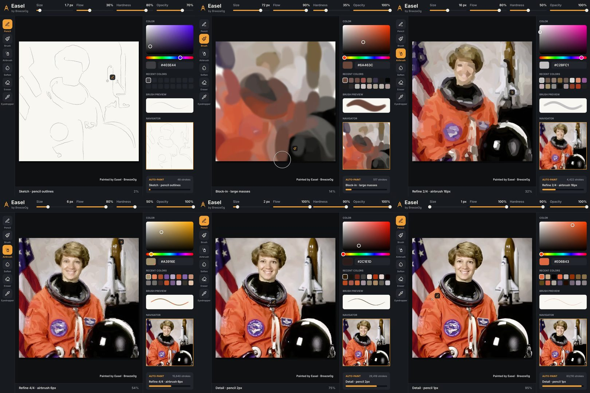
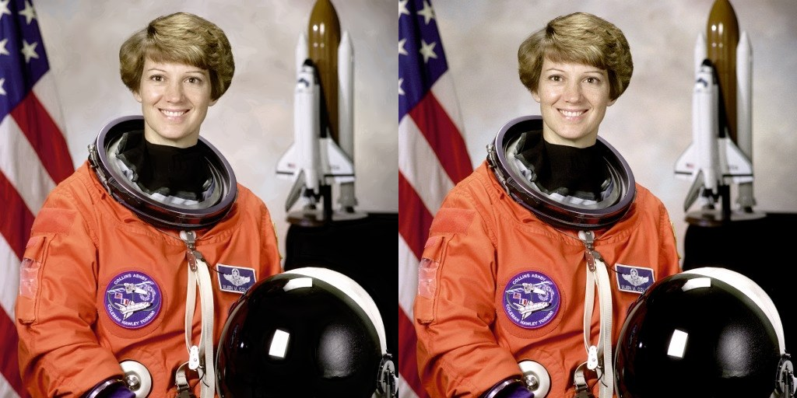

# Easel by BreezeOg

A browser painting app with an **auto-paint** mode that repaints any photo stroke by stroke and exports a **timelapse video** of the whole app while it works.

No AI image models are involved: every pixel on the canvas is laid down by a brush dab from the built-in software brush engine.



## Run it

```bash
npm install
npm run dev
```

Then open the URL Vite prints (http://localhost:5173 by default).

Other scripts:

| Command | What it does |
| --- | --- |
| `npm run build` | Type-checks (`tsc --noEmit`) and builds to `dist/` |
| `npm run preview` | Serves the production build |
| `npm run test:e2e` | Playwright end-to-end run (needs `npm run preview -- --port 4173` running, and Playwright + Chromium installed) |
| `scripts/tune.sh <image> [low\|med\|high] [realistic\|painterly\|sketch]` | Runs the auto-painter headlessly in Node and prints SSIM per pass (needs Python with Pillow and scikit-image) |

## Deploy to Vercel

The repo includes a `vercel.json` (framework `vite`, build `npm run build`, output `dist`).

- **From the dashboard:** import the GitHub repository at vercel.com/new and press Deploy. No settings need changing.
- **From the CLI:** `npm i -g vercel`, then `vercel` for a preview or `vercel --prod` for production.

It is a fully static site: no server, environment variables or API keys.

## Using the app

- **Tools (left):** Pencil, Brush, Airbrush, Soften/Blur, Eraser, Eyedropper. Shortcuts `P B A S E I`.
- **Top bar:** Size, Flow, Hardness, Opacity (remembered per tool), Open, Save PNG, undo/redo, zoom.
- **Right panel:** colour picker, recent colours, brush preview, navigator minimap, layers, auto-paint and timelapse controls.
- **Canvas:** wheel or pinch to zoom, Space-drag / middle-drag / two fingers to pan, `0` to fit, `[` `]` for brush size, `Ctrl+Z` / `Ctrl+Shift+Z`. Mouse, touch and pen pressure all work.
- **Layers:** a paint layer plus a reference layer that holds the opened photo and is hidden by default.
- **Open** a photo with the button or by dropping it on the window. Images are scaled to at most 1024 px on the long side (768 px on phones).

### Auto-paint

Open a photo, pick Detail (Low / Med / High), Style (Realistic / Painterly / Sketch) and Speed (1x–50x), then press **Start**. Pause and Stop work at any time, and the whole run is one undo step.

The painter works coarse to fine, and each pass looks at what is on the canvas so far:

1. **Sketch** – Canny edges traced into chains and drawn as thin, faint pencil strokes.
2. **Block-in** – large soft brush strokes in colours averaged from the reference, one colour family at a time.
3. **Refine** – several airbrush passes with shrinking brushes. Strokes follow the image's structure-tensor orientation and are placed where the canvas differs most from the reference.
4. **Blend** – soften strokes over smooth regions (skin, backgrounds) where brushwork left seams.
5. **Detail** – 3, 2 and 1 px pencil strokes on the remaining error, weighted towards high-detail areas (eyes, hair, edges).

While it paints, the UI shows what the painter is doing: the active tool, the sliders, the picked colour, the recent-colours grid and a cursor that travels along each stroke.

### Timelapse

Choose 1080×1080 or 1920×1080 and 15 / 30 / 60 s, then press **Export timelapse**. Every stroke is replayed into a 30 fps video of the whole app, the finished painting is held for the last 2 s, and a "Painted by Easel · BreezeOg" watermark sits in the corner. Manual strokes are included too.

Encoder order: H.264 MP4 through WebCodecs, then VP9/VP8 WebM through WebCodecs, then MediaRecorder (real-time). Append `?codec=webm` to the URL to force the WebM path.

The browser cannot capture its own DOM into a video frame, so the UI in the video is drawn onto a canvas from the same state that drives the real UI (`src/ui/scene.ts`).

## How it is built

Vite + TypeScript, no framework.

| File | Role |
| --- | --- |
| `src/engine/brush.ts` | Software brush engine: dabs with size, flow, hardness, per-stroke opacity, pressure; soften and erase |
| `src/engine/autopaint.ts` | Auto-paint planner (the five phases above) |
| `src/engine/imgproc.ts` | Blur, Sobel, structure tensor, Canny chains, SSIM |
| `src/engine/worker.ts` | Web Worker that owns the paint layer, undo history and the stroke log used for replay; decodes photos with `OffscreenCanvas` |
| `src/main.ts` | UI, pointer input, view, panels |
| `src/ui/recorder.ts`, `src/ui/scene.ts` | Timelapse encoding and frame rendering |

## What was verified

Run with Playwright in headless Chromium against the production build, using the public-domain NASA portrait in `tests/fixtures/portrait.jpg` (512×512).

- `npm run build`: zero TypeScript errors, zero build errors. No console or page errors in any run.
- **Auto-paint, High / Realistic / 50x:** 72,095 strokes in about 50 s. SSIM against the reference is **0.939** in-app and **0.940** measured separately with scikit-image on the saved PNG (target was ≥ 0.85).
- **Other photos, High / Realistic:** coffee cup 0.965, cat 0.970.
- **Other settings on the portrait:** Med 0.913, Low 0.831, Painterly 0.736, Sketch 0.737. Low and the two stylised modes are below 0.85; the stylised ones are meant to be.
- **30 s timelapse, 1080×1080:** H.264 High MP4, exactly 900 frames at 30 fps, 30.000 s, 12 MB, encoded in about 14 s. Six frames and the final image were inspected by eye: sketch → block-in → refine → detail, with the tool, sliders, colour and recents changing as expected. The painting was byte-identical before and after the export replay.
- **15 s timelapse, 1920×1080, forced WebM fallback:** VP9, 450 frames at 30 fps.
- **Manual painting:** all tools, eyedropper, wheel zoom, undo/redo and Save PNG exercised with the mouse.
- **Smoothness:** 60 fps with a worst frame of 17 ms while auto-painting, at 1440×900 and at a 390×844 touch viewport. On the phone viewport, touch painting, pinch zoom and the slide-over panel work and there is no horizontal overflow.

Not verified: the MediaRecorder fallback (Chromium never reached it), real pen hardware, and browsers other than Chromium.


